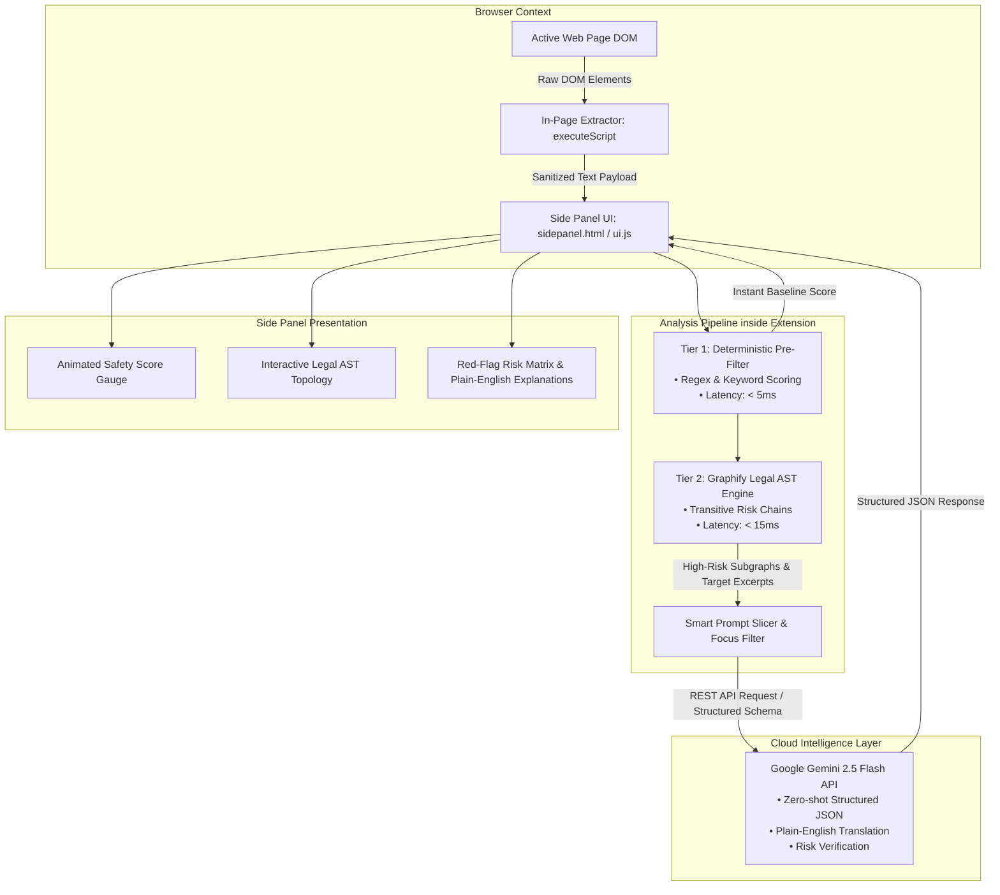
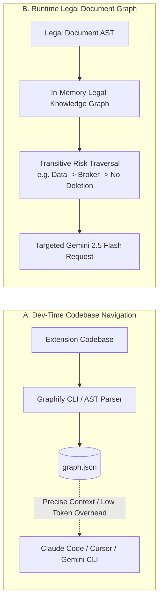
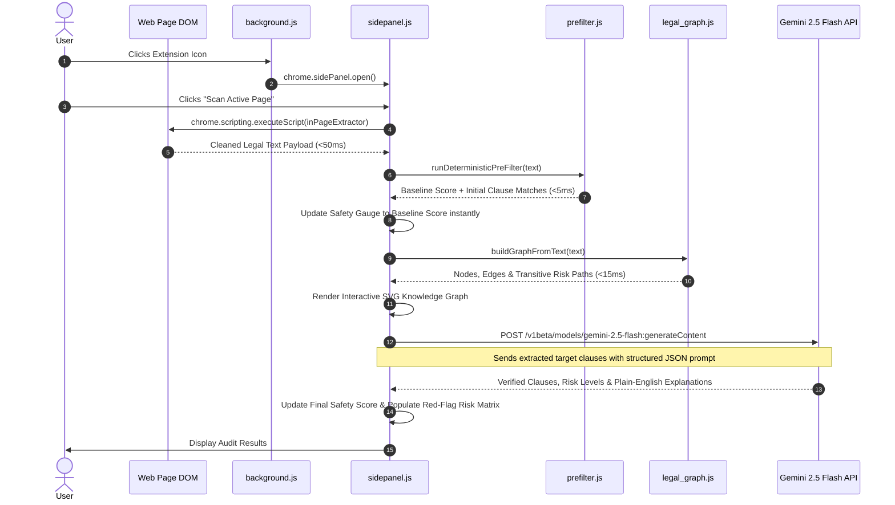

# Privacy Guard AI: Comprehensive Architecture & Technical Specification (Gemini 2.5 API Edition)

> **Target Environment:** Chrome Extension Manifest V3 (Side Panel API)  
> **Core Stack:** Google Gemini 2.5 Flash API | Chrome Extension Scripting & Side Panel | Graphify (AST & Legal Knowledge Graph)  
> **Extraction & Scoring:** Sub-50ms DOM Traversal | Tier 1 Deterministic Regex & Keyword Filter | Tier 2 Graphify Legal AST | Tier 3 Gemini API Zero-Shot Structured Classification  

---

## 1. Executive Summary & Problem Context

Virtually 100% of internet users click *"I Agree to the Terms & Conditions"* without reading them. A landmark study from Carnegie Mellon University estimated that thoroughly reading every privacy policy an average individual encounters in a year would take **244 hours — over 30 full working days**. 

Digital service providers exploit this by burying predatory clauses deep within dense legal text (class-action waivers, telemetry sales, perpetual content licensing, and auto-renewals).

**Privacy Guard AI** solves this crisis by deploying an ultra-fast, intelligent legal auditor built into Chrome. Operating directly from the Chrome Side Panel, the extension:
1. Automatically scrapes the active page's legal text in under 50ms.
2. Runs an instant Tier 1 deterministic regex pre-filter (<5ms) to calculate a baseline Safety Score ($1\text{--}100$).
3. Constructs an in-memory **Legal Knowledge Graph (LKG)** via Graphify's AST engine to detect hidden cross-clause risks (such as third-party broker routing and litigation rights forfeitures).
4. Leverages **Google Gemini 2.5 Flash API** to perform zero-shot structured clause classification, risk-level grading, and plain-English translations of predatory legalese—without downloading gigabytes of local weights into the browser.

---

## 2. Predatory Clause Risk Matrix & Scoring Mechanics

The extension categorizes predatory legalese into four primary risk vectors:

| Category | Predatory Industry Practice | Heuristic Match Example | Penalty & Severity |
| :--- | :--- | :--- | :--- |
| **Civil Litigation Waivers** | Forfeiture of constitutional rights via mandatory binding arbitration and class-action waivers. | `waive class action`, `binding arbitration`, `jury trial` | 🔴 **High (-30 pts)** |
| **Aggressive Data Monetization** | Irrevocable rights to sell, aggregate, or transfer personal telemetry, location history, & biometrics. | `sell personal info`, `data broker`, `third-party affiliate` | 🔴 **High (-25 pts)** |
| **Perpetual IP Claims** | Broad, worldwide, royalty-free perpetual licenses to retain and modify user-generated content. | `perpetual worldwide license`, `royalty-free`, `derivative works` | 🔴 **High (-20 pts)** |
| **Surprise Financial Mechanics** | Automatic subscription renewals without pre-billing notice and unilateral price modifications. | `automatically renew`, `modify without notice`, `sole discretion` | 🟡 **Medium (-15 pts)** |

### Mathematical Scoring Formula
To output a predictable, objective risk score between 1 and 100:

$$\text{Final Score} = \max\left(1, 100 - \sum_{i=1}^{n} W_i\right)$$

Where $W_i$ represents the penalty weight assigned to each discovered clause based on severity:
- **High-Risk Penalty ($W_i = 20\text{--}30$):** Class-action waivers, data sales to third parties, perpetual content licensing.
- **Medium-Risk Penalty ($W_i = 10\text{--}15$):** Location tracking, mandatory auto-renewals, unilateral policy changes.
- **Low-Risk Penalty ($W_i = 2\text{--}5$):** Standard functional cookies, basic account security terms.

---

## 3. High-Level System Architecture



---

## 4. Graphify Dual-Engine Integration

[Graphify](https://docs.graphify.com/quickstart) serves two distinct roles:



### Role A: Development & Codebase Navigation (Internal Dev Tool)
1. **Codebase Knowledge Graph (`graph.json`):** Maps cross-context interactions across `manifest.json`, `background.js`, `sidepanel.js`, `prefilter.js`, `legal_graph.js`, and `gemini.js`.
2. **Context Window Optimization:** When AI coding assistants work on features, they read `graph.json` rather than re-ingesting raw files. This reduces prompt tokens from ~30k to under 2k per turn.

### Role B: Structural Graph Analysis of Legal Documents (Product Feature)
Legal contracts deliberately isolate definitions from liabilities across disjoint sections. Graphify models the document into an in-memory directed Property Graph:
- **Entity Nodes:** `LegalClause`, `UserRight`, `DataType`, `ThirdPartyEntity`, `CompanyAction`.
- **Relationship Edges:** `WAIVES`, `EXTINGUISHES`, `COLLECTS`, `TRANSFERRED_TO`, `CIRCUMVENTS`.
- **Transitive Risk Detection:** If Section 2 collects *Telemetry*, Section 6 allows sharing with *Partners*, and Section 12 defines *Partners* as ad brokers, the graph identifies the direct path: `[User Telemetry] --TRANSFERRED_TO--> [Ad Brokers]`, sending targeted context to Gemini.

---

## 5. Chrome Extension Process Architecture

| Context | Script | Responsibilities & Constraints |
| :--- | :--- | :--- |
| **Active Tab** | In-page `inPageExtractor` | Injected via `chrome.scripting.executeScript`. Traverses target selectors (`main`, `article`, `.legal-doc`), prunes scripts/navs, runs in `< 50ms`. |
| **Service Worker** | `background.js` | Action routing, handling `chrome.action.onClicked`, opening the Side Panel via `chrome.sidePanel.open()`. |
| **Side Panel View** | `sidepanel.js` / `ui.js` | UI rendering (gauge dial, status indicators, graph visualization, risk cards), orchestrating the analysis pipeline. |
| **Pre-Filter Engine** | `prefilter.js` | Instant regex scanning and baseline penalty score calculation ($<5\text{ms}$). |
| **Legal Graph Engine** | `legal_graph.js` | In-memory Legal AST mapping, detecting transitive relationship chains ($<15\text{ms}$). |
| **Gemini Client** | `gemini.js` | Direct calls to Google Gemini 2.5 Flash API with strict JSON schema enforcement. |

---

## 6. End-to-End Sequence Diagram



---

## 7. Directory Structure

```
privacy-guard-ai/
├── manifest.json                  # Chrome MV3 manifest configuration
├── package.json                   # Project scripts and dependencies
├── vite.config.js                 # ES module bundler
├── .graphify/
│   └── graph.json                 # Role A: Codebase knowledge graph for AI coding agents
├── icons/
│   └── icon-128.png
├── src/
│   ├── background/
│   │   └── background.js          # MV3 Service worker & side panel router
│   ├── sidepanel/
│   │   ├── sidepanel.html         # Score gauge, status, risk matrix, graph canvas
│   │   ├── sidepanel.css          # Modern dark/light theme
│   │   ├── ui.js                  # DOM controller & orchestrator
│   │   └── graph_viewer.js        # SVG graph visualizer for legal AST nodes
│   ├── analysis/
│   │   ├── prefilter.js           # Tier 1 deterministic regex heuristics
│   │   ├── legal_graph.js         # Tier 2 Legal AST knowledge graph & path analyzer
│   │   └── gemini.js              # Tier 3 Google Gemini 2.5 Flash client
│   └── shared/
│       └── constants.js           # Risk weights, penalties, configuration
```

---

## 8. Performance Benchmarks

| Metric / Parameter | Target SLA | Engine Component |
| :--- | :--- | :--- |
| **DOM Scraping Latency** | $\le 50\text{ ms}$ | `inPageExtractor` via `chrome.scripting.executeScript` |
| **Tier 1 Heuristic Score** | $\le 5\text{ ms}$ | `prefilter.js` (synchronous regex scanning) |
| **Tier 2 Graphify AST Graph Pass** | $\le 15\text{ ms}$ | `legal_graph.js` (in-memory property graph) |
| **Initial UI Feedback** | $\le 25\text{ ms}$ | Gauge dial updates to baseline score immediately |
| **Tier 3 Gemini 2.5 Flash Inference** | $\approx 800\text{--}1500\text{ ms}$ | Cloud API call with focused prompt payload |
| **Extension Bundle Size** | $\approx 250\text{ KB}$ | No heavy multi-gigabyte ONNX models required in browser memory |
